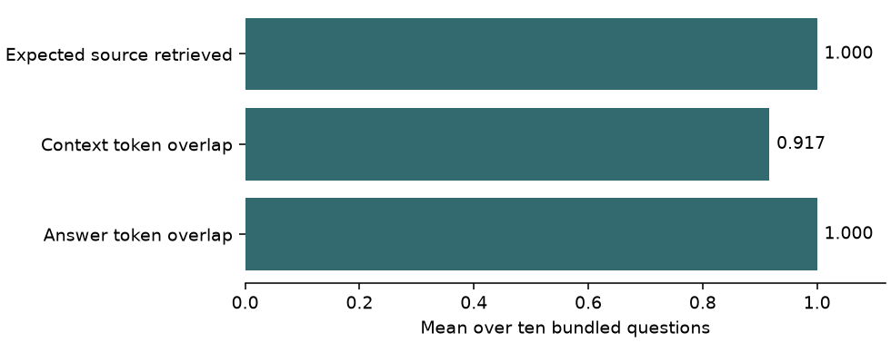
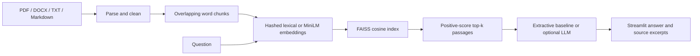

# Atlas

**An engineering-document assistant with inspectable retrieval and source-linked answers.**

Upload technical manuals, architecture notes, and specifications; ask questions; inspect the passages behind an answer. Atlas combines a FastAPI service, FAISS cosine retrieval, and a Streamlit workspace. The default installation runs without provider accounts or pretrained model downloads after dependencies are installed.

## Quick start

Requires Python 3.12+ and internet access for dependency installation. Run from the repository root:

```sh
python3 -m venv .venv
source .venv/bin/activate
pip install -r requirements-dev.txt
python -m uvicorn backend.main:app --host 127.0.0.1 --port 8000
```

In a second terminal:

```sh
source .venv/bin/activate
streamlit run frontend/app.py --server.address 127.0.0.1
```

Open http://localhost:8501. Choose **Ingest Documents → Ingest Sample Data**, then ask “What is the maximum operating temperature of the heat exchanger?” Sample engineering values are fictional demonstration data, not operational guidance. Repeated ingestion of identical chunks is deduplicated.

API reference: http://localhost:8000/docs. Set `ATLAS_API_URL` to change the frontend's backend address.

## Results and evaluation on the bundled corpus

The expected source appeared in retrieval for all ten bundled questions. The local extractive baseline scored 0.92 on context relevance and 1.00 on answer faithfulness, both token-overlap heuristics. The index contains just two sample documents, so source hits are a low bar here. [Per-question outputs](docs/results/questions.json).



## Verification

```sh
pytest -q
ruff check app backend frontend scripts tests
ruff format --check app backend frontend scripts tests
```

Tests exercise chunking, retrieval, snapshot reload, duplicate ingestion, upload path safety, sample ingestion, validation, generation, and metrics. Default tests need no model download or paid API. Live provider calls and pretrained semantic-model quality require separate validation.

Run **one API process/worker**: the index is cached in process memory. Atomic snapshots prevent partially written persistence files, but do not provide multi-process synchronization. Back up `data/index/` while the service is stopped. Do not place untrusted snapshot files in this directory.

## Architecture



| Layer | Implementation |
|---|---|
| API and validation | FastAPI, Pydantic |
| Retrieval | FAISS normalized inner product, equivalent to cosine similarity |
| Default representation | Deterministic signed feature hashing, 2,048 dimensions |
| Optional semantic representation | Sentence Transformers, all-MiniLM-L6-v2 |
| Parsing | pypdf, python-docx, Markdown and plain text |
| Generation | Local extractive answer; optional OpenAI or Anthropic |
| Persistence | Atomic NumPy snapshot with JSON metadata; no pickle loading |
| Verification | pytest, Ruff, Streamlit application tests, GitHub Actions |

The hashed baseline matches lexical features and can have hash collisions; it is **not a pretrained semantic model**. It offers a small, account-free baseline for demonstrations. Semantic embeddings require separate installation and a model download.

## Optional semantic retrieval and generation

Copy `.env.example` to `.env`. For semantic retrieval:

```sh
pip install -r requirements-semantic.txt
```

```dotenv
EMBEDDING_BACKEND=sentence-transformers
EMBEDDING_MODEL=all-MiniLM-L6-v2
INDEX_DIR=./data/semantic-index
```

Restart and ingest again. A fresh index directory is required when changing embedding configuration. Old pickle/FAISS snapshots are intentionally not loaded; reingest source documents.

For provider generation, set `GENERATION_MODE=openai`, `OPENAI_API_KEY`, and `OPENAI_MODEL`; or use `GENERATION_MODE=anthropic`, `ANTHROPIC_API_KEY`, and `ANTHROPIC_MODEL`. Choose a model available to your account. Missing keys or provider failures fall back to local extraction, and the response reports the generator actually used. Provider generation sends questions and selected passages to that provider.

## Evaluation

```sh
python -m scripts.ingest_sample_data
python -m scripts.run_evaluation
```

The dataset lives in `evaluation_data/qa_dataset.json`. Review the script's output options with `--help`.

- **Retrieval hit:** expected source appears in the retrieved filenames.
- **Context relevance:** fraction of passages sharing question tokens.
- **Answer faithfulness:** a token-overlap heuristic over answer sentences.

These are diagnostic proxies, not calibrated factuality measures or independent LLM judgments. The small authored corpus is not evidence of general accuracy. No measured superiority over other retrieval systems is claimed. A research extension would compare lexical and semantic retrieval on held-out relevance labels, measure latency, vary chunk size/top-k, and analyze failure cases.

## API

| Endpoint | Purpose |
|---|---|
| `GET /health` | Service configuration and index size |
| `POST /ingest/upload` | Multipart `files`; PDF, DOCX, TXT, MD |
| `POST /ingest/directory` | Bundled sample documents only |
| `POST /query/ask` | JSON `question` and optional `top_k` |

Uploads are limited to 10 files per request and 25 MB per file by default. Uploaded originals are temporary and removed after parsing; index snapshots retain extracted text and metadata. Source names are display labels, not trusted filesystem paths. Avoid uploading sensitive documents to a shared installation.

## Verification notes

The local default configuration passed 30 tests and lint/format checks on Python 3.14. The ingestion and evaluation scripts ran end to end. These checks do not validate the optional pretrained semantic backend or live provider integrations.

## Scope and limitations

Atlas is a local, single-workspace portfolio application, not a production-certified engineering system. There is no user authentication, workspace isolation, OCR, distributed index, or formally verified answer grounding. Keep it on loopback; add authentication and HTTPS before network exposure. Engineering documents can contain prompt injection, and generated output can be incorrect. Source presence alone does not prove a claim. Review original documents before making decisions.

## Repository guide

- `app/ingestion/`: document loaders, cleaning, chunking
- `app/retrieval/`: representations, index, search
- `app/generation/`: extractive and provider adapters
- `app/evaluation/`: diagnostic evaluation
- `backend/main.py`: API entry point
- `frontend/app.py`: Streamlit workspace
- `tests/`: automated checks

## License

[MIT License](LICENSE) for the project code. Third-party software, models, and datasets retain their own terms.
